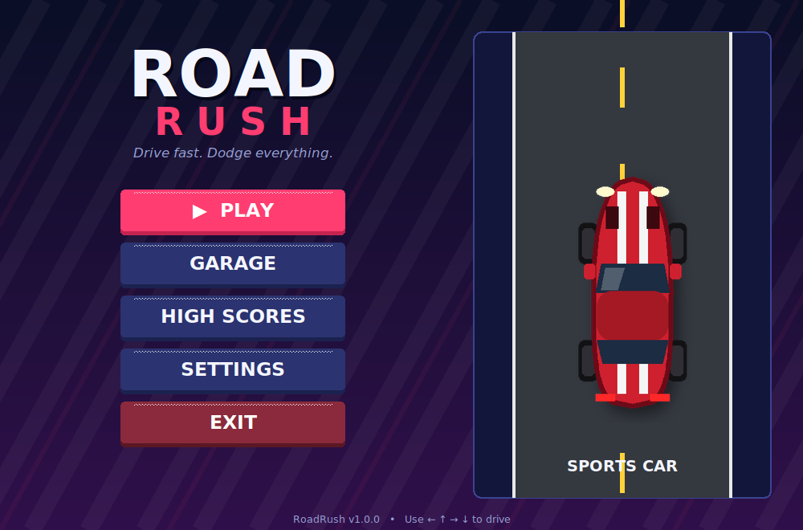
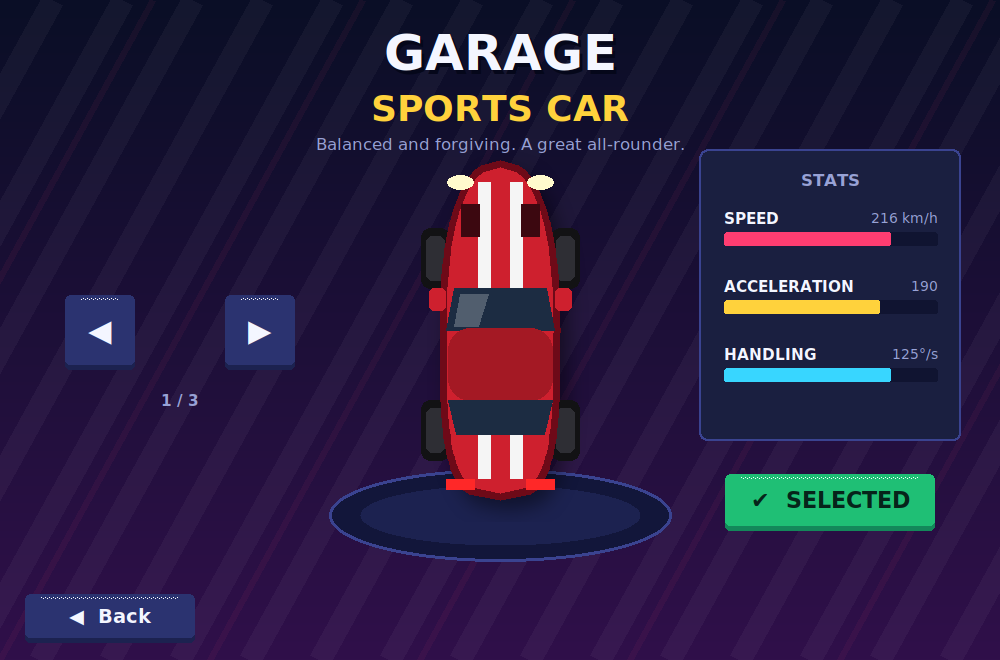
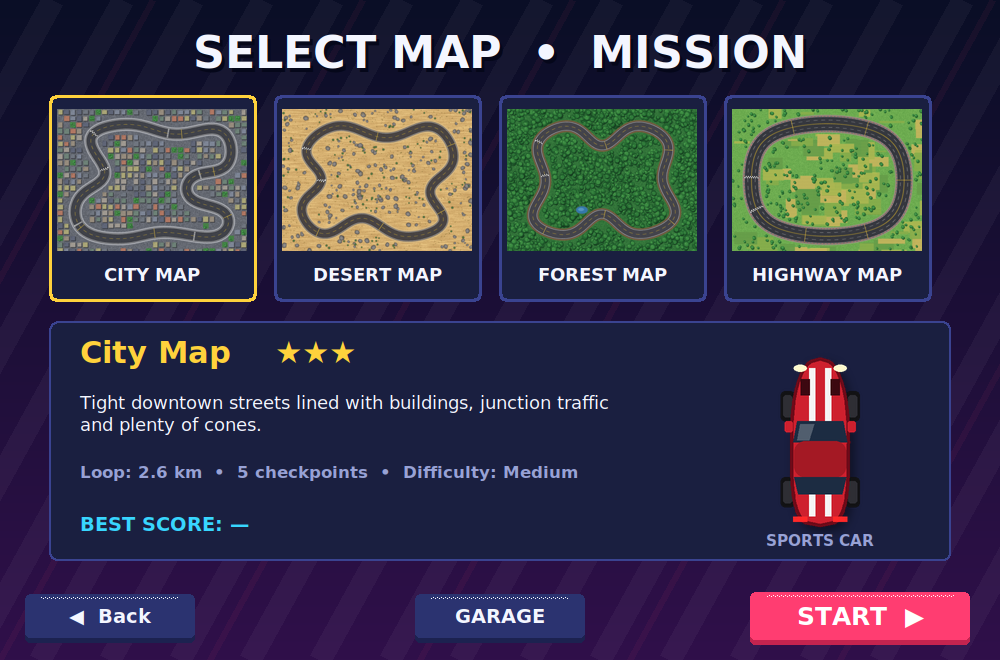
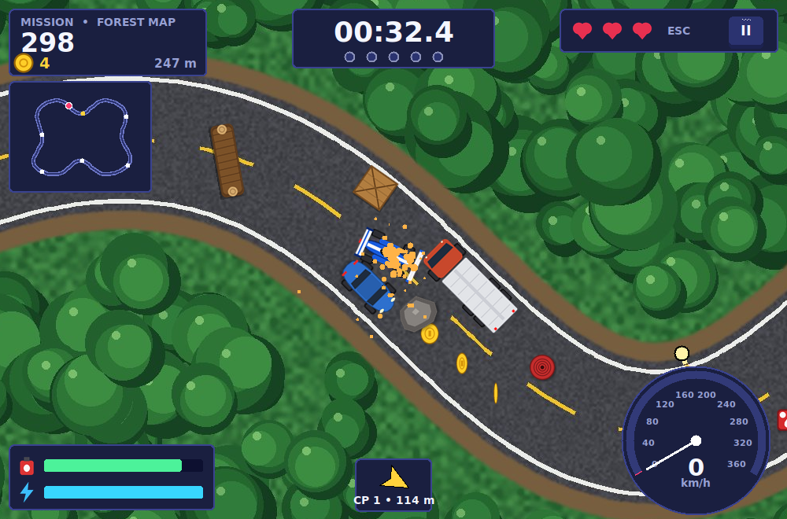
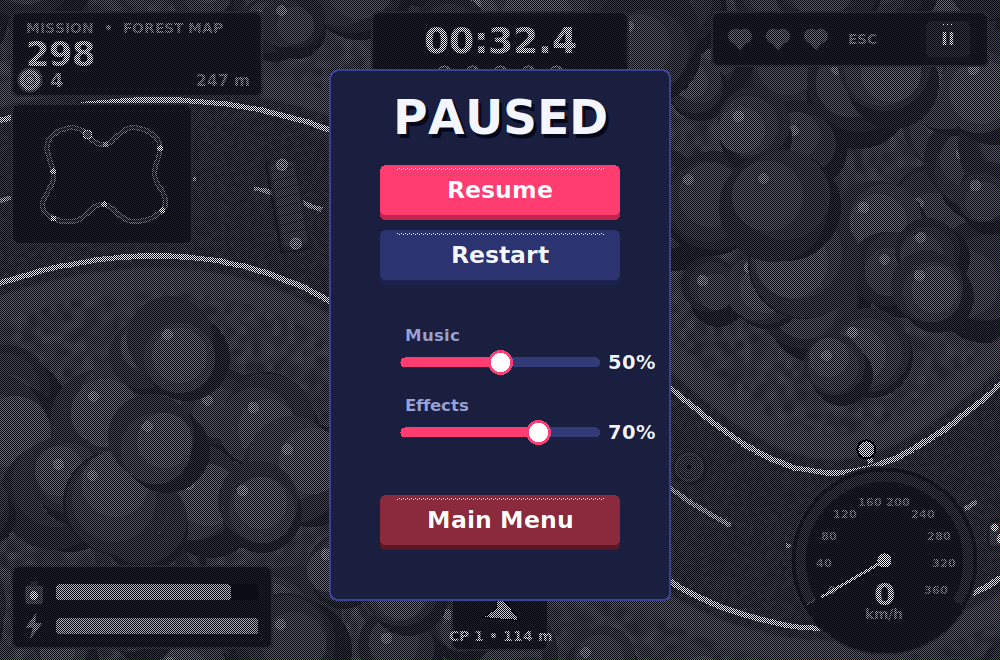
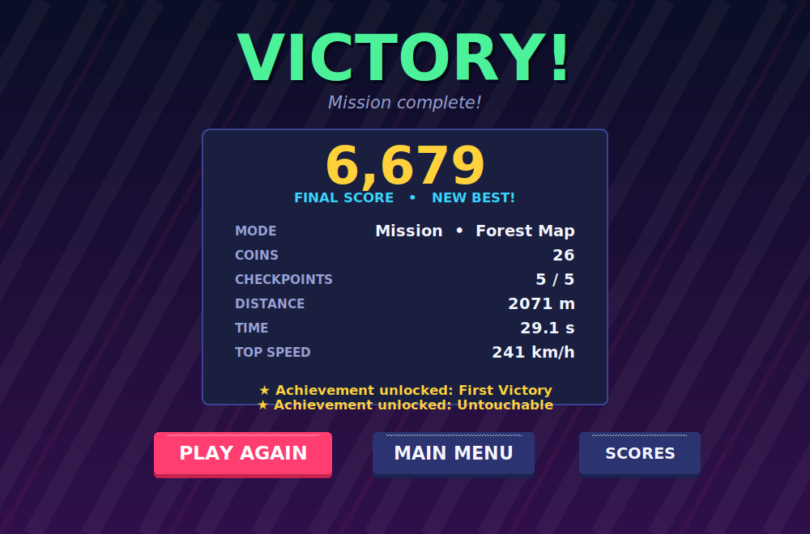

# RoadRush 🏁

**RoadRush** is a polished 2D top-down arcade driving game written in **Python 3.12** with
**Tkinter Canvas** rendering. Pick a car, pick a map, and race through checkpoints (Mission Mode) or survive
as long as you can while traffic and obstacles keep getting tougher (Endless Mode).

| Main menu | Garage | Map selection |
|---|---|---|
|  |  |  |

| Gameplay | Pause menu | Victory |
|---|---|---|
|  |  |  |

## Features

* **3 cars** – Sports Car, Racing Car, Supercar – each with its own top-down image, large garage preview,
  and distinct speed / acceleration / handling. Your selection is saved.
* **4 playable maps** – City, Desert, Forest, Highway. Every map is a real road circuit with a pixel-accurate
  road mask, start position, finish line, 5 checkpoints, obstacle positions, coins, fuel cans, lane-based traffic
  and a unique look.
* **Driving physics** – acceleration, drag/rolling resistance, braking, reverse, speed-dependent steering,
  lateral grip with **handbrake drifting**, nitro boost, per-car handling. Movement is time-based
  (frame-rate independent) and runs from one `after()` loop – nothing teleports.
* **Mission Mode** – 5 ordered checkpoints (+time bonus each), timer, 3 lives, traffic, obstacles, coins, finish line.
  Victory / Game Over / Mission Failed (time up) screens.
* **Endless Mode** – no finish line, traffic and obstacles spawn ahead and ramp up in difficulty over time,
  score from distance + survival + coins, high score saved per map.
* **Collision & rules** – oriented-rectangle (SAT) collisions for car vs. traffic, obstacles, checkpoints, coins,
  fuel and finish; road boundaries are checked with **all four wheels** against a road mask (not just the car's centre);
  push-out response, invulnerability cool-down (no multi-hit), blink + red flash + screen shake + sparks.
  Staying off-road too long costs a life and respawns you on the road.
* **Fuel** (pick up cans), **nitro** (recharges), **speedometer**, **minimap**, objective arrow, countdown.
* **Difficulty** Easy / Medium (default) / Hard – changes traffic speed & density, obstacle frequency, mission timer,
  checkpoint bonus, crash penalties, off-road grace and endless ramp-up.
* **Audio** – engine sound that changes with speed, music, effects, volume sliders (pygame mixer, audio only).
* **Persistence** – settings, selected car/map, top-10 scores per map & mode, lifetime stats and 6 achievements are
  saved as JSON in `data/` and survive corrupt/missing files.
* **All assets included and original** – art, maps and audio are generated by code (`tools/generate_assets.py`).

## Technology stack

* Python 3.12 · Tkinter (GUI + Canvas rendering) · Pillow (image processing / sprite rotation / map generation)
* pygame **mixer only** for sound and music (Tkinter Canvas is the only renderer)
* JSON for saves, settings and map layouts · `unittest` for tests · no threads are needed

## Installation (Windows 10/11)

Install Python 3.12 from <https://www.python.org/downloads/> (keep **"tcl/tk and IDLE"** ticked), then in
PowerShell or Command Prompt:

```bat
cd path\to\roadrush
py -3.12 -m venv .venv
.venv\Scripts\activate
pip install -r requirements.txt
python main.py
```

PowerShell users who get an execution-policy error when activating can run
`Set-ExecutionPolicy -Scope Process RemoteSigned` first, or use `cmd.exe`.

macOS / Linux: `python3 -m venv .venv && source .venv/bin/activate && pip install -r requirements.txt && python main.py`
(Linux also needs the Tk package, e.g. `sudo apt install python3-tk`).

If there is no sound device, or pygame cannot start, the game still runs – silently.

## Controls

| Key | Action |
|---|---|
| ↑ (or W) | Accelerate |
| ↓ (or S) | Brake / reverse |
| ← → (or A / D) | Steer |
| Space | Handbrake (drift) |
| Shift (or N) | Nitro boost |
| Esc | Pause / resume (the pause menu has restart, volume sliders and *Main Menu*) |

## Game rules

* **Mission:** you have **3 lives** and a countdown timer. Drive through the 5 glowing gates **in order**
  (each adds bonus seconds), then cross the checkerboard finish line.
  Time runs out → *Mission Failed*; lives run out → *Game Over*.
* **Endless:** survive as long as possible. No finish line. Traffic and obstacles increase every ~30 s.
* Crashing into traffic or obstacles costs **one life** and slows you down; you are invulnerable (blinking) for a
  short time afterwards. Cones, barrels and crates are knocked away; rocks, logs, barriers etc. are solid.
* **Off-road:** if 3+ wheels leave the asphalt, speed is capped and an off-road timer starts. Get back on the road
  before it ends or you lose a life and are put back on the road.
* **Fuel** drains while driving – collect red fuel cans. An empty tank that stays stopped is Game Over.
* **Coins** = 50 points each. Score = distance + coins + checkpoints (+ time/lives bonus on victory, + survival in Endless).

## Project structure

```
roadrush/
├── main.py                  entry point
├── requirements.txt
├── README.md
├── game/
│   ├── app.py               window + screen navigation + shared services
│   ├── menus.py             splash, main menu, mode/map select, garage, settings, scores, result
│   ├── gameplay.py          gameplay screen: the single after() loop, input, pause menu
│   ├── engine.py            GameSession: all rules/simulation (no GUI)
│   ├── modes.py             Mission and Endless mode rules + spawning
│   ├── car.py               car specs + physics
│   ├── collision.py         SAT oriented-box / circle collision helpers
│   ├── map.py               map loading, road mask, fallbacks
│   ├── mapgen.py            procedural map layout + background rendering
│   ├── roadpath.py          closed-loop road geometry
│   ├── entities.py          obstacles, pickups, traffic, checkpoints
│   ├── camera.py            smooth, clamped scrolling camera
│   ├── renderer.py          Canvas world renderer (tiles, sprites, particles)
│   ├── hud.py               HUD (score, lives, timer, speedometer, minimap ...)
│   ├── ui.py / sprites.py   theme, canvas widgets / image cache
│   ├── procart.py           procedural sprite drawing
│   ├── audio.py             pygame.mixer wrapper (safe no-op fallback)
│   ├── settings.py          settings + difficulty profiles
│   └── save_manager.py      scores, stats, achievements
├── assets/                  cars/ maps/ obstacles/ ui/ sounds/   (all included)
├── data/                    scores.json, settings.json
├── tests/                   unit + GUI tests
├── tools/                   generate_assets.py, soundgen.py (regenerate every asset)
└── docs/screenshots/
```

Layering: `engine`/`modes`/`car`/`collision` know nothing about Tkinter and are fully unit-tested;
`renderer`/`hud`/`gameplay`/`menus` only draw and forward input.

## Running the tests

```bat
python -m unittest discover -s tests -v
```

The GUI tests (`tests/test_gui_smoke.py`) open real Tk windows and drive them with synthetic mouse/key events;
they are skipped automatically if no display is available. They use a temporary folder, never your `data/` folder.
On a headless Linux box run them with `xvfb-run -a python -m unittest discover -s tests -v`.

## Regenerating assets

`python tools/generate_assets.py` rebuilds all images, maps and sounds (about 10 s).
Missing images or map files are also rebuilt automatically at runtime, so the game never starts with broken references.

## Credits & licensing

All graphics, maps and sounds are original and generated by the code in this repository, so no third-party
attribution is required. Fonts are not bundled: the game uses *Segoe UI* on Windows (falling back to other
system fonts). Libraries: Pillow (HPND) and pygame (LGPL).

## Known limitations / future improvements

* Traffic cars do not react to obstacles (they can drive through them) and do not collide with each other.
* The sidewalk/shoulder around a road counts as "off-road" (only the asphalt is road).
* The window is a fixed 1000×660 (no resizing / fullscreen); keyboard only (no gamepad).
* Sounds are simple synthesized chiptune-style effects.
* Ideas: more cars with unlockable upgrades, a coin shop, weather, ghost laps, gamepad support, online leaderboards.
